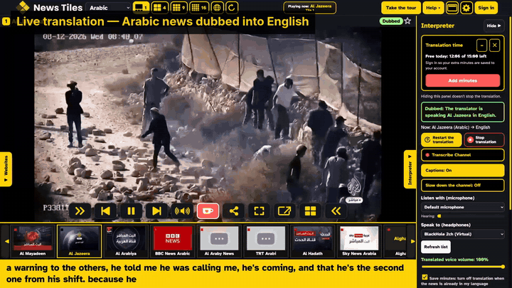
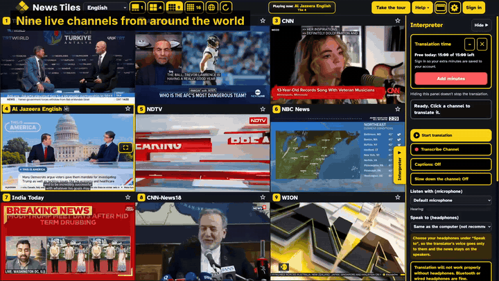
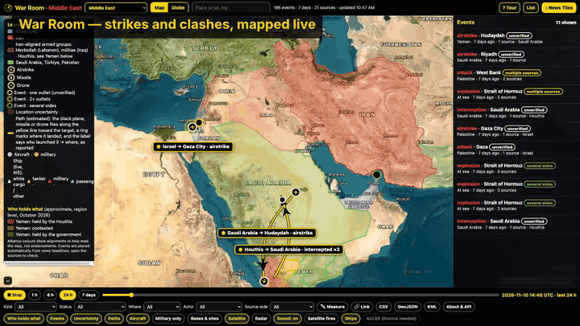
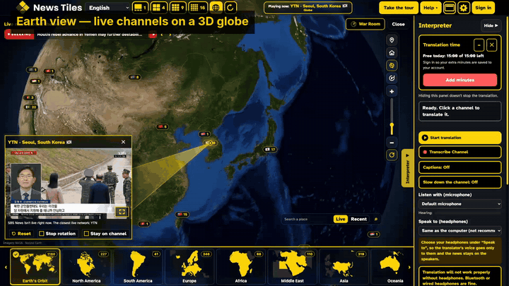

# News Tiles

**Live world news, side by side, translated into your language as it happens.**
Live site: **[thenewstiles.com](https://thenewstiles.com)**

News Tiles is a multi-screen live news command center. Watch live TV from dozens of countries on one wall,
hear any broadcast translated into your language in real time, and follow conflicts as they unfold in the War Room.
It is built accessibility-first: large high-contrast design, adjustable captions and full screen-reader support.

> This repository is a **showcase**. The News Tiles source code is private. What's here explains what it does,
> shows it working, and includes a small code sample.

## What it does

- **Tiles wall** — watch 1, 4, 9 or 16 live channels at once from countries around the world, with a gallery view and
  per-tile full screen.
- **Live translation** — hear a broadcast in your own language in real time, with captions you can slow down or enlarge.
- **28 languages** — the whole interface is available in 28 languages.
- **War Room** — a live conflict map: air strikes, drone strikes, ground clashes, who holds what ground and live aircraft,
  with alerts.
- **Earth's Orbit** — live channels placed on a 3D globe; spin to a region and start watching.
- **News Room** (in testing) — a live news map for a country, starting with the Philippines, gathering local stories
  in English, Tagalog, Bisaya and more, placed on the map and translated.
- **Accessible by design** — yellow on black, large text, screen-reader mode, guided tour, keyboard control.
- **Also on TV and in the browser** — an Android TV app and a browser extension share the same engine.

## Built with AI, directed by one person

News Tiles was designed, tested and shipped by one legally blind builder directing a team of AI coding agents.

- First change: 27 October 2026. Over **311 saved changes** and **170+ numbered versions** in under three weeks.
- Every change is tested on a test site first and goes live only on the owner's say-so.

See **[HOW-IT-WORKS.md](HOW-IT-WORKS.md)** for the overview.

## See it working

**Watch the 80-second tour: [media/news-tiles-highlights.mp4](media/news-tiles-highlights.mp4)**

| Live translation (Arabic → English) | Nine channels at once |
| --- | --- |
|  |  |
| **War Room** | **Earth view** |
|  |  |

## Code sample

[code-samples/i18n_build.py](code-samples/i18n_build.py) is the tool that keeps all 28 languages in sync. It checks that every
translation exists, keeps every formatting tag and placeholder, and builds the language file the app loads. If anything
is missing or broken it reports the problem and the release does not go out.

## Rights

© 2026 Shane Hill. All rights reserved. Shown for portfolio purposes; see [LICENSE](LICENSE).
